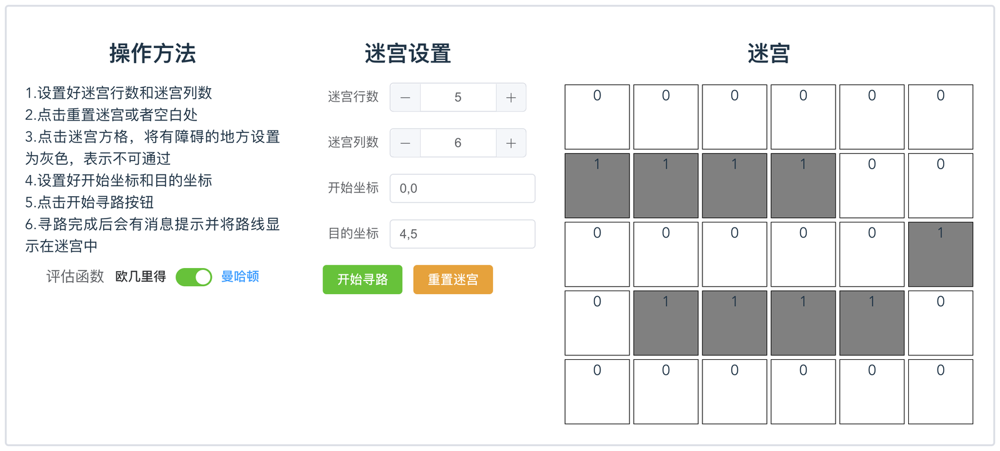
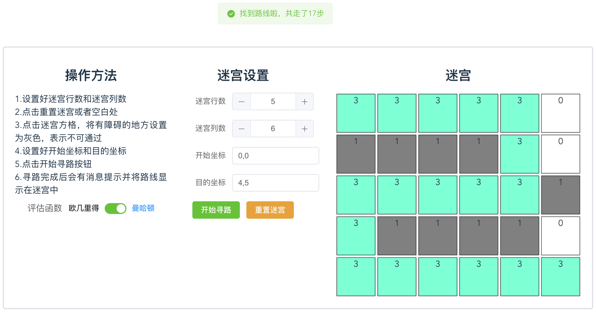

# A* 算法求迷宫最优路径（可视化）

用 A* 做迷宫最短路径的网页应用：自己画迷宫、点起点终点、跑算法，直接看 open/closed 表的扩展过程和最终路径。

课程作业（人工智能课，2023-01，两人小组），把图搜索讲清楚比把功能堆起来更重要，所以做成了可视化。

## 功能

- 网格大小可调（`row` × `col`），点格子切换「墙／通路」
- 起点、终点可任意设定（默认 `0,0` → `2,2`）
- 启发函数可切换：曼哈顿距离 / 欧几里得距离
- 按 A* 展开：维护 `open` / `closed` 两张表，`f(n)=g(n)+h(n)` 排序，扩展过程可视化
- 输出最优路径与步数；找不到解时给出提示

## 实际跑起来的样子

下图是 5 行 6 列的迷宫：灰色格子是障碍（值为 `1`），把起点设为 `0,0`、终点设为 `4,5`，点「开始寻路」后，浅蓝色格子（值为 `3`）就是 A* 找到的最优路径，右上角消息提示总步数。





## 技术栈

Vue 3 + Element Plus + Vite。算法用 JS 直接写在 `src/App.vue`（`mapNode` 类 + `findStep` 四邻域算子），`src/test.js` 是同一套算法的独立脚本版，方便在 node 里单独跑。

## 跑起来

```sh
pnpm install      # 或 npm install
pnpm dev          # 打开终端里给出的地址
pnpm build        # 产物在 dist/
```

## 实现要点

- **节点**：`status`（坐标）、`step`（g 值，已走步数）、`fn`（f 值）、`lastStep`（上一步方向，用来禁止原地回头）、`father`（父节点链，回溯路径用）。
- **算子**：上下左右四邻域，越界和墙（`maze[x][y]==1`）不扩展。
- **去重**：`notOpen` / `notClosed` 检查节点是否已在表里，若新路径 `fn` 更小就替换，否则丢弃 —— 这是 A* 能收敛到最优的关键。
- **启发函数**：曼哈顿距离适合四邻域移动；欧几里得距离在同一网格上会低估得更多，扩展的节点也更多，可以对比着看。
- **网格规模小（默认 3×3）是为了课堂演示清楚**，改 `row` / `col` 就能放大。

## 课程报告（原文）

下面是当时交的课程报告，保留原始写法，方便对照：

## A*算法求解迷宫问题

### 案例介绍

人工智能(Artificial Intelligence ,简称AI) 是近几年来游戏业最炙手可热的研究领域。现代生活中，我们需要在不确定的空间里面寻找一些特定的东西将会需要的越来越多。比如说游戏里面的寻找一条最优解的路径、机器人在一个未知的空间里面救援，这些都是生活中可以应用上的方面， 其中涉及一个寻找路径的问题,即AI 中的图搜索技术。所谓搜索问题,就是在地图上的起点A 和目标点B 之间寻找一条可通行的路径。显然, A 和B 之间可以有很多条路径,我们的目的是用最短的时间找到最佳路径。 在起点A 和目标点B 之间寻找一条最佳路径,其本质就是搜索,是一个从初始节点出发,沿着与之相连的边试探前进,寻找目标节点的过程。 

采用A*算法求解迷宫问题能够比较快速高效的求得问题的解，为此我们设计了一个可视化应用，用于设置迷宫和寻找最短路径。

### 需求分析

1. 首先是功能设计，我们需要输入一个迷宫数据，并且设置好起始点和目标点，然后根据算法输出路径和行走步数。
2. 算法设计。也就是将输入转化成输出的过程，使用A*算法进行计算。
3. 界面交互设计。用户需要用简单便捷的方式将地图信息绘制输入进来。然后用直观的方式将结果输出出来。

### 项目设计

#### 总体设计

人工智能应用通常是由python来实现的，但考虑到python在用户交互与界面设计上并不占优势，使用前后端分离的设计又会有网络延迟和隐私泄露的问题，应用将会十分臃肿。因此使用了V8引擎的nodejs语言成为了我们的首选，在运行速度上不亚于python，而且可以在用户浏览器直接运行，减少了隐私泄露的问题，还充分运用了客户端过剩的计算能力。

而界面设计则使用十分成熟的vue3前端框架，配合element ui实现方便快捷的应用建立，响应式渲染让交互设计变得触手可得，并且可以将nodejs应用无缝迁移，让应用可以快速实装。

#### 算法设计

1. A*算法利用包含启发式信息的评价函数对节点进行排序，因此需要确定几个重点。

2. 首先是评估函数f(n)=g(n)+h(n)，n是任意位置节点，g(n)是从起始状态到n的代价，我们就将行走步数作为g(n)。h(n)是对n到目标状态代价的启发式估计，要寻找迷宫的最短路径，就要找离目的点最近的点，因此g(n)要包含当前节点到目的节点距离，我们将曼哈顿距离作为h(n)，即：

   h(n)=|end.x – n.x|+ |end.y – n.y|

   这里 end 表示迷宫的目标点，n 表示当前点。

3. 然后操作算子需要进行设计，在迷宫中通常有上下左右四个操作算子，根据实际情况需要确定真正合适的算子，考虑是否有围墙障碍物，是否出界，防止走回头路等等。

4. 然后要设计各个节点保存的信息，即节点类或者节点结构体。

   首先是节点所在的位置需要保存下来，用于判断操作算子、计算评估函数和最后输出结果路径，然后是当前走过的步数，初始节点步数为0，其他节点通常由父节点的步数+1得到，然后评估函数fn的值需要根据上面两个参数进行计算并且保存下来，用于之后的排序，然后是上一次的操作算子记录下来，防止走回头路，最后是路径列表，也称为族谱，用于保存路径，通常是父节点的路径列表+父节点自己的坐标。

5. 然后是迷宫信息，包括迷宫的行数列数，迷宫中墙的位置，起始节点的位置，目的节点的位置。

6. 实现A*算法还要借助open表和closed表，open表中存放还未扩展的节点，closed表中存放已扩展的节点。

7. 最后的流程就是初始化open表和closed表为两个空列表，建立一个起始节点的实例，将起始节点信息输入进去，插入open表，开始算法循环。

8. 循环的算法。首先需要为open表中的节点排序，根据每个节点的fn进行升序排序。然后取出表头的节点，判断该节点的坐标是否为目标坐标，如果条件符合则找到路线，循环终止，输出路径。不符合条件就要进行扩展，首先计算合适的操作算子，然后对每个可能的操作算子进行遍历操作，分别创建新的节点，判断是否在open表或者closed表中，如果都不存在，则视为全新节点加入open表。父节点加入到closed表中，循环结束没有找到目标节点则输出迷宫无解。

#### 界面设计

1. 界面包括操作方法、迷宫信息设置和迷宫三部分。
2. 操作方法就使用一个简单的文本框，信息是固定的所以不用修改。下方增加了一个评估函数
3. 迷宫信息则使用一个表单组件，可以使文字和组件对齐，使用两个数字输入框和两个文字输入框分别用于输入迷宫行数、列数还有初始节点和目标节点的坐标。下面添加两个按钮用于开始寻路和迷宫重置。其中行列数进行了数据限制，无法降低到0以下，而位置坐标如果设置不合理也会有消息提示。
4. 迷宫就使用传统的div+css设计，使用黑色边框强调迷宫块的位置，然后为不同的状态设计不同的背景颜色，比如白色就是可以正常通过的格子，黑色就是墙，而绿色是最后计算出来的路径。
5. 找到结果路径之后会弹出消息提示，并且将路径显示在迷宫地图中。如果没有找到路径会输出无解。
6. 最后将三个大模块框起来，使整个应用更加美观。

### 实现与测试

####实现

1. 本作实际上是一个vue应用。因此使用vite构建vue3应用，只使用app.vue一个文件，实现包括算法和界面等所有功能。

2. 一开始初始化几个参数，包括open表，closed表，开始坐标，目的坐标，迷宫行数，迷宫列数，迷宫数据等。其中open表和closed表初始化为一个空数组，开始坐标和目的坐标是数组，为了能够响应式的获取开始坐标和目的坐标，使用了两个响应式变量，绑定在两个文字输入框中，当用户改变输入框中的值时，会触发函数改变相应的坐标变量。迷宫行数和列数直接初始化为响应式变量，绑定在两个数字输入框中。迷宫的数据设置成一个二维数组，同时也是响应式变量，初始化时，按照行数和列数生成对应的全零二维数组。

3. 用户操作。迷宫中每一个格子的数据都有对应的状态。0代表没有障碍可以通过，颜色为白色;1代表是围墙，不可以通过，颜色为灰色;3代表的是找到的路径，颜色为绿色。当用户点击迷宫中的格子时，会触发事件，修改当前格子在迷宫中对应的数据，如果之前的数据为0，就会被修改为1，如果之前的数据为非0的数据，就会被修改为0。当用户点击重置迷宫时，会将二维数组的所有数据置为0。

4. 节点类设置。使用 class 关键字来创建一个Node类，然后使用constructor构造函数完成类的初始化，主要包括以下几个属性，status节点位置，step走过的步数，fn评估函数值，lastStep上一个操作算子，father路径列表。

   ```js
   class mapNode {
     constructor(status, lastStep, step, father) {
       this.status = status;
       this.step = step; //类中变量
       // 曼哈顿距离
       if(mhd.value){
         this.fn =
         step +
         Math.abs(status[0] - goal[0]) +
         Math.abs(status[1] - goal[1]);
       }else{
             // 下面是欧几里得距离
         this.fn =
         step + Math.sqrt((status[0] - goal[0]) * (status[0] - goal[0]) + (status[1] - goal[1]) * (status[1] - goal[1]))
       }
       this.lastStep = lastStep;
       this.father = father;
     }
   }
   ```

5. 执行函数。当点击开始寻路按钮之后执行的方法。主要包括判断开始坐标的目的坐标是否越界，将开始坐标初始化为Node节点，插入open表，通过open表进行主要算法的循环，循环条件为open列表不为空。

6. 主要算法。首先使用sort方法为open表中的节点排序，依据每个节点的fn进行升序排序。然后使用shift方法取出表头的节点，判断该节点的坐标是否为目标坐标，如果条件符合则找到路线，循环终止，输出路径，路径为该节点的father列表值。不符合条件就要进行扩展，首先计算合适的操作算子，判断进行上下左右操作之后是否越界，是否撞墙，是否走回头路，然后对每个可能的操作算子进行map遍历操作，分别创建新的Node节点，判断是否在open表或者closed表中，如果存在，则判断fn值是否更小，如果更小则取代他插入open表。如果都不存在，则视为全新节点加入open表。父节点加入到closed表中，循环结束没有找到目标节点则输出迷宫无解。

####测试

1. 界面展示。首先打开该网页，发现包括三大板块，操作方法，迷宫设置和迷宫。条理清晰，方法明确，可以直观的进行使用和操作。

   

2. 寻路演示。一开始已经为我们提供了一个3X3的迷宫地图，开始坐标和目的坐标，所以可以直接点击开始寻路进行计算。点击之后发现系统提示找到路线和行走步数，一旁的迷宫上也显示出对应的路径信息。

   

3. 修改迷宫信息。可以修改地图的行列数以及开始目的坐标，另外也可以修改评估函数为欧几里得距离。点击迷宫格子，可以将空白设置为墙。

   

   

   

4. 容错演示。当该迷宫无解时，会有无解提示。迷宫行列数，最少为0。开始坐标和目的坐标越界会有提示。

   

   

   

   

5. 不同评估函数结果可能不同。

   

   


### 总结

> 两个人整合，可以不分篇

本次人工智能应用设计很有意思。不仅应用A*算法解决了一个迷宫问题，设计过程也是收获满满。首先是更加熟悉了A *算法的流程，以后构建A *算法问题有了一个高效可用的模板框架。而且能够更加熟练地使用python，js，vue等多种语言，包括之前设计的八数码算法是使用python语言进行编写，这次使用js语言再次实验感觉效果也十分不错。另外在修改bug的途中也明白了很多函数的使用方法，比如数组和对象的遍历，响应式二维数组，动态样式的设计等等。目前界面设计比较方便的就是网页设计方式了，有成熟的操作体系和配套框架，对于大部分简易应用来说，直接使用前端设计是一个不错的选择。

## License

MIT（见 `LICENSE`）。这是课程作业，欢迎参考思路，别直接当成自己的作业交。
